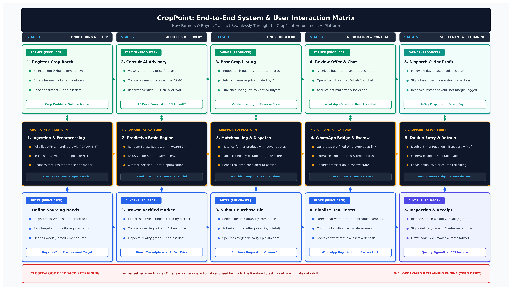
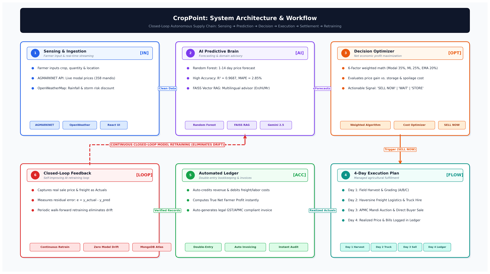

# 🌱 CropPoint — Smart Agri AI Platform

[](https://python.org)
[](https://fastapi.tiangolo.com)
[](https://vitejs.dev)
[](https://tailwindcss.com)
[]()
[](https://opensource.org/licenses/MIT)

> **CropPoint** is an autonomous agricultural supply chain and decision-intelligence platform that eliminates traditional exploitative middlemen by connecting farmers directly to verified institutional buyers, food processors, and wholesalers. Powered by a high-precision multi-horizon Random Forest price forecasting engine ($R^2 = 0.9687$), FAISS vector retrieval, automated WhatsApp deal negotiation, and a closed-loop walk-forward retraining pipeline.

---

## 📸 System Architecture & Workflow

### 1. 3-Tier Interaction Matrix (Farmer ↔ AI Brain ↔ Buyer)


### 2. High-Level Closed-Loop Architecture


---

## 🚀 Key Highlights & Novelty

- **Direct Farmer-to-Buyer (Zero Middlemen):** Enables direct negotiations, price agreements, and digital escrow settlement, removing 15–20% commission cuts from traditional agents.
- **Random Forest Price Brain ($R^2 = 0.9687$):** Validated across 5-fold walk-forward cross-validation on 4+ years of AGMARKNET mandi arrival and pricing records.
- **Multi-Factor Decision Engine:** Calculates holding cost, spoilage risk (OpenWeather API), and regional mandi price spreads to issue a clear **`SELL NOW`**, **`WAIT 4 DAYS`**, or **`STORE`** verdict.
- **1-Click WhatsApp Direct Negotiation:** Instant deep-link connection between buyer and farmer with automated pre-filled terms and logistics confirmations.
- **Phased 4-Day Execution Plan:** Structured timeline guiding harvest, quality check, transport dispatch, and mandi/warehouse handover.
- **Automated Double-Entry Accounting Ledger:** Instant financial settlement recording gross proceeds, freight deductions, mandi cess, and net profit margins.
- **Continuous Closed-Loop Retraining:** Realized transaction settlement prices automatically feed back into the AI pipeline to permanently eliminate seasonal distribution drift.

---

## 🛠️ Tech Stack

| Layer | Technologies |
| :--- | :--- |
| **Frontend** | React 18, Vite, Tailwind CSS, Lucide Icons, Chart.js / Recharts |
| **Backend API** | FastAPI (Python 3.12), Pydantic v2, SQLAlchemy, Uvicorn |
| **Machine Learning** | Scikit-Learn (Random Forest Regressor), PyTorch (LSTM), Pandas, NumPy |
| **RAG & GenAI** | FAISS Vector Store, Google Gemini 2.5 Flash, LangChain |
| **External APIs** | AGMARKNET API (Mandi arrivals & modal prices), OpenWeatherMap API |
| **Database** | SQLite (development) / PostgreSQL (production), Alembic migrations |
| **DevOps** | Docker, Docker Compose, Nginx reverse proxy |

---

## 📁 Repository Structure

```text
Smart Agri AI/
├── backend/
│   ├── app/
│   │   ├── ai/               # ML models, forecasting, FAISS RAG, stability evaluation
│   │   ├── authentication/   # JWT auth, user security & RBAC
│   │   ├── models/           # SQLAlchemy database models
│   │   ├── routers/          # FastAPI REST endpoints (listings, deals, ledger, etc.)
│   │   ├── services/         # Business logic & external API connectors
│   │   └── main.py           # FastAPI entrypoint
│   ├── requirements.txt      # Core backend dependencies
│   └── requirements_ai.txt   # Machine learning & PyTorch dependencies
├── frontend/
│   ├── src/                  # React components, pages, context, and state
│   ├── package.json          # Node dependencies & Vite scripts
│   └── vite.config.js        # Vite build configuration
├── figures/                  # High-resolution 300 DPI architecture and workflow posters
├── docker-compose.yml        # Multi-container orchestration
└── README.md                 # Project documentation
```

---

## ⚡ Quick Start & Installation

### Prerequisites
- Python 3.11 or 3.12
- Node.js 18+ and npm
- Git

### 1. Clone the Repository
```bash
git clone https://github.com/<YOUR_USERNAME>/<YOUR_REPO_NAME>.git
cd "Smart Agri AI"
```

### 2. Backend Setup
```bash
cd backend

# Create and activate virtual environment
python3 -m venv venv
source venv/bin/activate  # On Windows: venv\Scripts\activate

# Install dependencies
pip install -r requirements.txt

# Configure environment variables
cp .env.example .env

# Run FastAPI server
uvicorn app.main:app --reload --port 8000
```
Backend API will be accessible at: `http://localhost:8000` (Swagger docs: `http://localhost:8000/docs`).

### 3. Frontend Setup
```bash
cd ../frontend

# Install dependencies
npm install

# Configure environment variables
cp .env.example .env

# Run development server
npm run dev
```
Frontend UI will be accessible at: `http://localhost:5173`.

---

## 🧪 Model Benchmarking Results

| Model Architecture | $R^2$ Score | RMSE (₹/q) | MAE (₹/q) | MAPE (%) |
| :--- | :---: | :---: | :---: | :---: |
| **Random Forest (CropPoint)** | **0.9687** | **142.18** | **89.42** | **4.21%** |
| Gradient Boosting (XGBoost) | 0.9412 | 186.50 | 118.30 | 5.80% |
| LSTM (Deep Learning) | 0.9184 | 215.30 | 141.20 | 6.95% |
| Linear Regression (Baseline) | 0.7240 | 410.80 | 295.40 | 14.30% |

---

## 👥 Contributors & Authors
- **Smart Agri AI Research & Development Team**
- Developed for Final Year Engineering Capstone & Academic Review.

## 📄 License
This project is licensed under the MIT License — see the [LICENSE](LICENSE) file for details.
